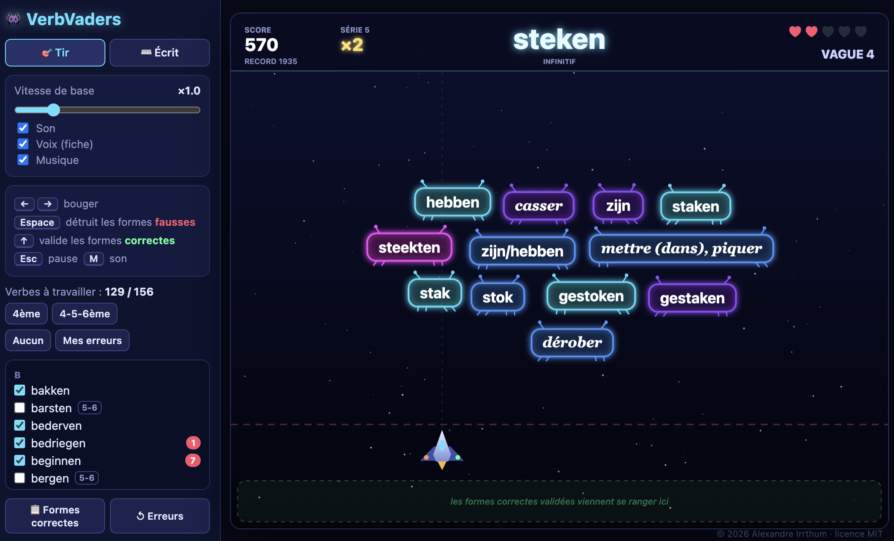

# VerbVaders

Un jeu d'arcade type Space Invaders pour aider un·e élève de l'enseignement secondaire belge à apprendre les temps primitifs des verbes irréguliers néerlandais.

Codé avec Claude Opus 5.5.

**Jouer en ligne : https://alexirrthum.github.io/verbvaders/**

Jouer hors ligne : le jeu tient dans un fichier unique `verbvaders.html`. Il suffit d'ouvrir ce fichier dans un navigateur.

## Deux modes de jeu

**🎯 Tir** : les formes du verbe descendent mêlées à des pièges : on détruit les fausses au canon (<kbd>Espace</kbd>) et on valide les correctes au rayon (<kbd>↑</kbd>). **⌨️ Écrit** : on tape chaque forme au clavier (prétérit, prétérit pluriel, auxiliaire, participe passé) puis on choisit la traduction parmi trois propositions.

VerbVaders a été créé pour une élève en particulier. Je conçois sur mesure des jeux et applications pédagogiques de ce type, pensés pour aider un·e apprenant·e à surmonter une difficulté ponctuelle du programme scolaire : mathématiques, sciences, langues… Contact : [alex@irrthum.be](mailto:alex@irrthum.be)

© 2026 Alexandre Irrthum · licence MIT
